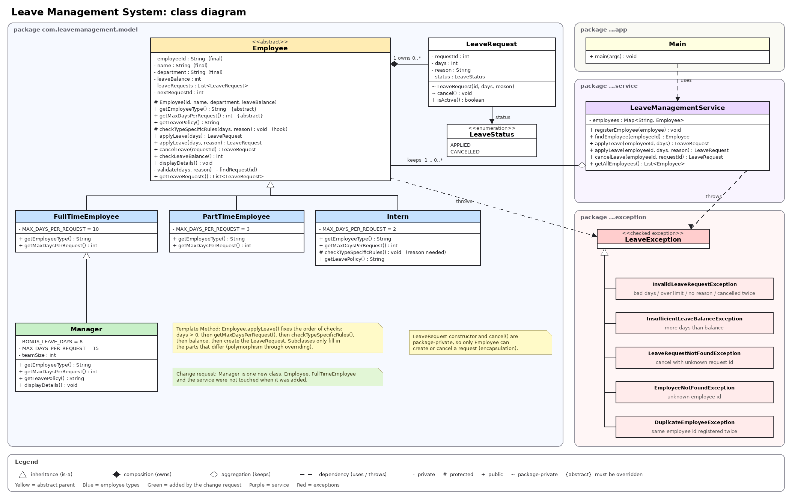
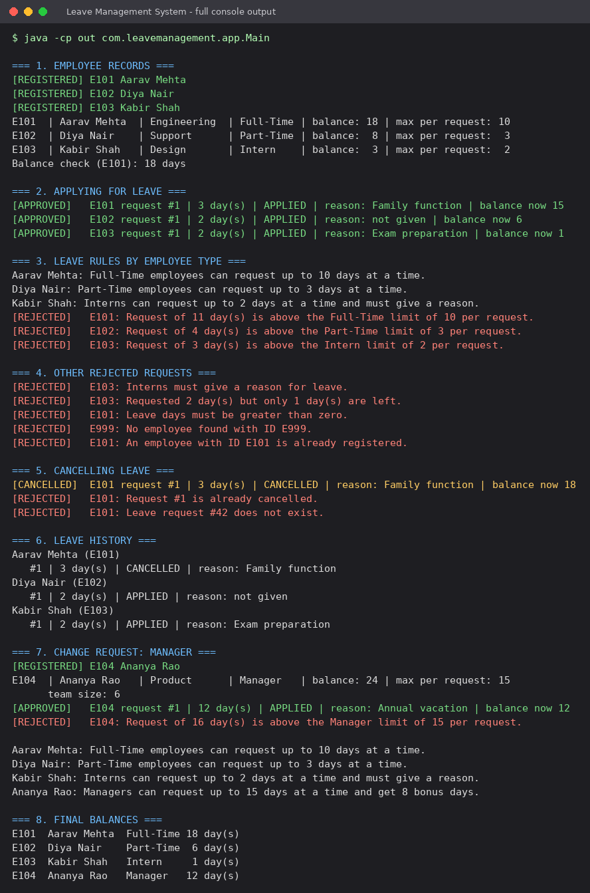

# Leave Management System

A Java console application that stores employee records, handles leave requests and applies different leave rules depending on the type of employee. It was built step by step to practise object-oriented programming, then refactored.

**GitHub repository:** https://github.com/YOUR-USERNAME/Leave-Management-System

## Requirements

- JDK 11 or later (tested on JDK 17 and 21)
- Any editor, for example VS Code

No external libraries are used.

## How to run

Run these from the project root, the folder that contains `README.md` and `src`.

**Windows (PowerShell)**

```powershell
Get-ChildItem -Recurse src\main\java -Filter *.java | ForEach-Object { $_.FullName } | Set-Content sources.txt
javac -d out @sources.txt
java -cp out com.leavemanagement.app.Main
```

**Linux / macOS / Git Bash**

```bash
javac -d out $(find src/main/java -name "*.java")
java -cp out com.leavemanagement.app.Main
```

To run the self-checks as well:

```bash
javac -d out $(find src -name "*.java")
java -cp out com.leavemanagement.LeaveSystemChecks
```

`out/` and `sources.txt` are ignored by Git.

## Project structure

```text
Leave-Management-System/
├── src/
│   ├── main/java/com/leavemanagement/
│   │   ├── app/Main.java
│   │   ├── model/
│   │   │   ├── Employee.java            (abstract)
│   │   │   ├── FullTimeEmployee.java
│   │   │   ├── PartTimeEmployee.java
│   │   │   ├── Intern.java
│   │   │   ├── Manager.java
│   │   │   ├── LeaveRequest.java
│   │   │   └── LeaveStatus.java
│   │   ├── service/LeaveManagementService.java
│   │   └── exception/                   (LeaveException + 5 subclasses)
│   └── test/java/com/leavemanagement/LeaveSystemChecks.java
├── docs/
│   ├── design.md
│   ├── class-diagram.md
│   ├── class-diagram.mmd
│   ├── oop-concepts.md
│   ├── refactoring-notes.md
│   ├── requirements-checklist.md
│   └── images/
├── sample-output/
│   ├── console-output.txt
│   ├── test-output.txt
│   └── screenshots/
├── .gitignore
└── README.md
```

## Leave rules

The numbers are example values chosen for the assignment, not a real company policy.

| Type | Max days per request | Other rule |
|---|---|---|
| Full-Time | 10 | none |
| Part-Time | 3 | none |
| Intern | 2 | a reason must be given |
| Manager | 15 | 8 bonus days added to the starting balance |

For every type: days must be more than zero and cannot exceed the current balance.

## What each class does

- `Employee`: abstract parent. Holds ID, name, department, leave balance and the list of leave requests, and contains the apply / cancel / check / display logic.
- `FullTimeEmployee`, `PartTimeEmployee`, `Intern`: give their own limit (and, for the intern, the reason rule).
- `Manager`: the change request. Extends `FullTimeEmployee` with a higher limit, bonus days and a team size.
- `LeaveRequest`, `LeaveStatus`: one request with an id, days, reason and status (`APPLIED` or `CANCELLED`).
- `LeaveManagementService`: registers employees, rejects duplicate IDs, finds employees and passes leave operations to them.
- `LeaveException` and subclasses: one exception per kind of failure.
- `Main`: runs the demonstration.
- `LeaveSystemChecks`: 19 small checks of the rules, written without a test library.

## Class diagram



The editable Mermaid version, a sequence diagram and a state diagram are in [docs/class-diagram.md](docs/class-diagram.md). GitHub draws them in the page.

## Sample output

The full text is in [sample-output/console-output.txt](sample-output/console-output.txt) and the self-check results are in [sample-output/test-output.txt](sample-output/test-output.txt).



Screenshots of each part of the demo are in [sample-output/screenshots](sample-output/screenshots):

| File | Shows |
|---|---|
| `01-employee-records.png` | employees created and displayed |
| `02-applying-for-leave.png` | approved requests, with and without a reason |
| `03-leave-rules-by-employee-type.png` | polymorphism: each type's rule and a rejection for each |
| `04-other-rejected-requests.png` | exceptions for the other rule breaks |
| `05-cancelling-leave.png` | cancel, cancel again, unknown request |
| `06-leave-history.png` | requests and their status |
| `07-change-request-manager.png` | Manager added and tested |
| `08-final-balances.png` | balances at the end |
| `09-self-checks.png` | 19 checks passing |
| `10-git-commit-history.png` | commit history |

## Documentation

| File | What it covers |
|---|---|
| [docs/design.md](docs/design.md) | objects, data, behaviour, classes, relationships, decisions |
| [docs/oop-concepts.md](docs/oop-concepts.md) | every OOP concept used, where, why, and study questions |
| [docs/refactoring-notes.md](docs/refactoring-notes.md) | what was wrong, what was changed, before and after |
| [docs/requirements-checklist.md](docs/requirements-checklist.md) | each point of the assignment and where it is covered |

## Git history

```text
Initial employee design
Added Employee class
Implemented leave management
Added inheritance: FullTimeEmployee, PartTimeEmployee, Intern
Implemented polymorphism, abstraction and overloading
Added Manager
Refactored code: template method, custom exceptions, LeaveRequest, service layer
Added self-check tests for leave rules
Final version: documentation, diagrams and sample output
```

## Limitations

Employees are kept in memory only, requests have no dates and there is no approval step. These were left out on purpose because they are beyond the assignment.
