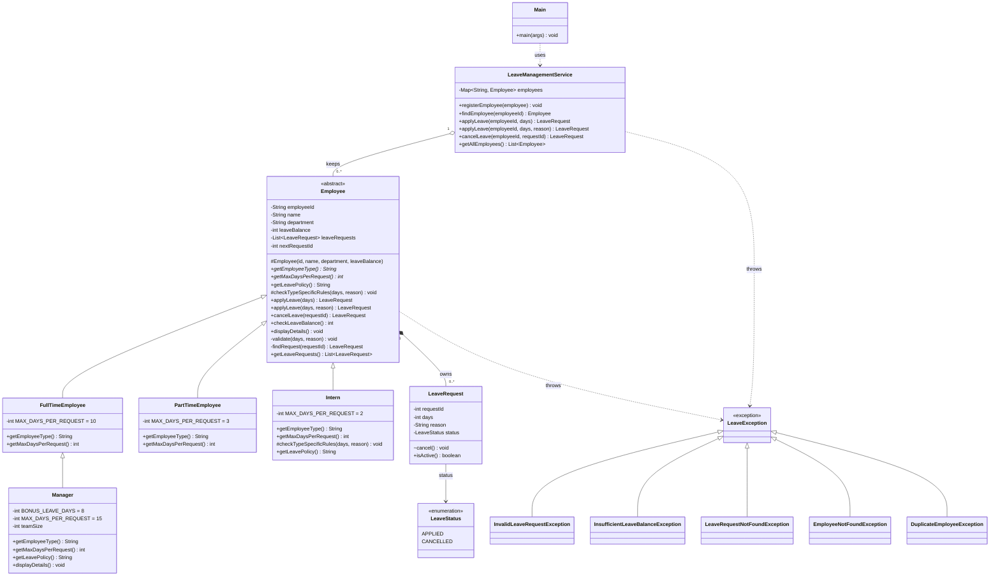
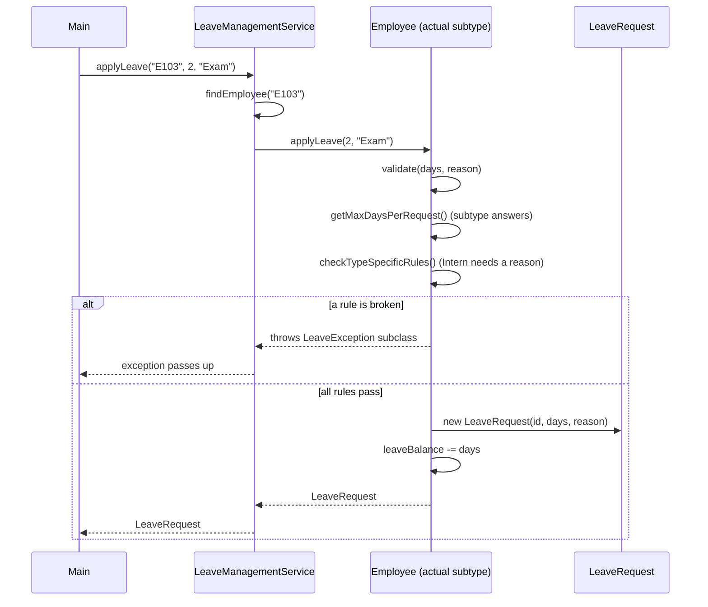
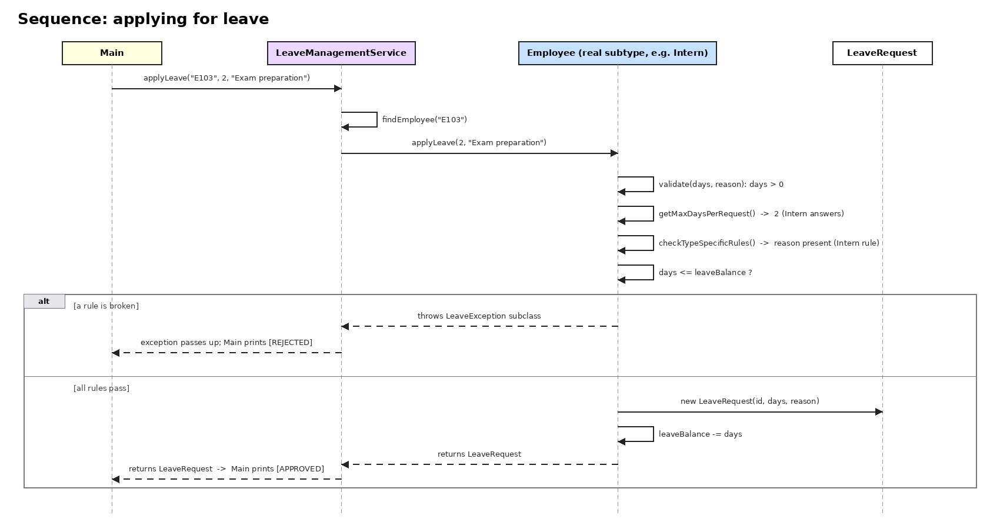
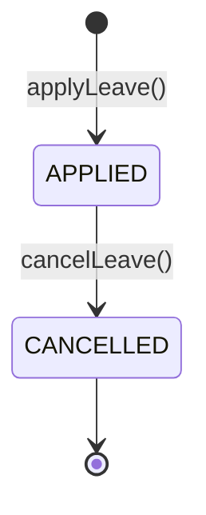

# Class Diagram

The diagrams below are Mermaid, so GitHub draws them directly in this page. The same diagrams are also saved as images in `docs/images/` for the PDF report. The raw class diagram source is in [class-diagram.mmd](class-diagram.mmd).

## 1. Class diagram

### How to read it
| Symbol | Meaning | Example here |
|---|---|---|
| `<\|--` | inheritance (is-a) | `Intern` is an `Employee` |
| `*--` | composition (owns, cannot live without the owner) | `Employee` owns its `LeaveRequest` objects |
| `o--` | aggregation (keeps, but the parts can exist alone) | the service keeps `Employee` objects |
| `..>` | dependency (uses or throws) | `Employee` throws `LeaveException` |
| `-` `#` `+` `~` | private, protected, public, package-private | `LeaveRequest.cancel()` is package-private |
| `*` after a method | abstract method | `getMaxDaysPerRequest()` |

### Notes on the design
- Only `Employee` has the leave workflow. The four subclasses only describe what is different about them.
- `Manager` extends `FullTimeEmployee`, not `Employee`, because a manager is a full-time employee with extra benefits. It overrides only the limit, the policy text and `displayDetails()`.
- `LeaveManagementService` knows only about `Employee`. Adding `Manager` needed no change in it.
- `LeaveRequest.cancel()` and its constructor are package-private, so only `Employee` can create or cancel a request. Other classes cannot change a request's status.

## 2. Sequence: applying for leave

## 3. Life of a leave request

A cancelled request cannot be cancelled again, and cancelling restores the days to the balance exactly once.
